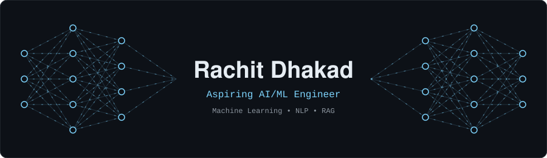

<p align="center">
  
</p>

```python
# In [1]
from rachit import profile

profile.summary()
```

```text
# Out[1]
name    : Rachit Dhakad
role    : 3rd-year CSE student | Aspiring AI/ML Engineer
college : RGPV, Bhopal
stack   : Python, C++, SQL, Scikit-learn, Pandas, NumPy, NLP, RAG
status  : Open to Internships & Full-Time Roles
```
<div align="center">

[](https://git.io/typing-svg)


</div>

---

### 👋 Hey, I'm Rachit

I'm a third-year Computer Science student who likes building machine learning projects from the idea all the way to a live app.

I work mostly with Python, and I enjoy projects where ML, NLP and data come together into something people can actually use. My focus right now is becoming an AI/ML Engineer.

**Certifications:** Oracle OCI Data Science • Google – Introduction to AI

---

<p align="center">
  <b>Development Environment</b>
</p>

<p align="center">
  <br>
  <sub>Python • C++ • SQL • Scikit-learn • Pandas • NumPy • NLP • RAG • Flask • Streamlit • MySQL • Git • GitHub • Jupyter</sub>
</p>

<!-- =========================================================== -->
<!--                    ENGINEERING LOG                          -->
<!-- =========================================================== -->

<h1 align="center">
  <br>
  Engineering Log
</h1>

<p align="center">

</p>

<p align="center">
<i>A collection of projects I've built and deployed.</i>
</p>

<p align="center">
━━━━━━━━━━━━━━━━━━━━━━━━━━━━━━━━━━━━━━━━━━━━━━━
</p>

---

## CareerLens

<p>
  
  
</p>

> **AI Career Assistant**

```text
STATUS      ● LIVE
DOMAIN      Artificial Intelligence • NLP
BUILT ON    Python • Streamlit • NLP • RAG
DEPLOYED    Streamlit Cloud
```

AI-powered resume analysis, career recommendations, skill-gap analysis and job discovery.

**Core Features**

`Resume Analysis` • `Career Recommendations` • `Skill-Gap Analysis` • `Job Discovery`

[Live Demo](https://careerlens-assistant.streamlit.app/) · [GitHub](https://github.com/rachitdhakad45/CareerLens)

---

## Credit Card Default Prediction

<p>
  
  
  
  
</p>

> **Classification / Risk Prediction**

```text
STATUS      ● LIVE
DOMAIN      Machine Learning
BUILT ON    Python • Scikit-learn • Pandas • NumPy • Streamlit
DEPLOYED    Streamlit Cloud
```

ML-based prediction of whether a credit card customer will default on their payment.

**Core Features**

`Default Prediction` • `Exploratory Data Analysis` • `ML Modeling` • `Interactive Web App`

[Live Demo](https://credit-defaulter.streamlit.app/) · [GitHub](https://github.com/rachitdhakad45/Credit-Card-Default-Prediction)

------

## Development Dashboard

<p align="center">


</p>

<p align="center">

</p>

-----

## Let's Connect

<div align="center">

<table>
<tr>

<td align="center">
<a href="https://www.linkedin.com/in/rachit-dhakad/" target="_blank">
<br>
<b>LinkedIn</b>
</a>
</td>

<td width="55"></td>

<td align="center">
<a href="mailto:rachit.dhakad45@gmail.com">
<br>
<b>Email</b>
</a>
</td>

<td width="55"></td>

<td align="center">
<a href="https://github.com/rachitdhakad45" target="_blank">
<br>
<b>GitHub</b>
</a>
</td>

</tr>
</table>

</div>

---

<div align="center">

```python
while True:
    learn()
    build()
    improve()
```

<sub><b>Thanks for visiting.</b> See you in the next commit. </sub>

</div>
